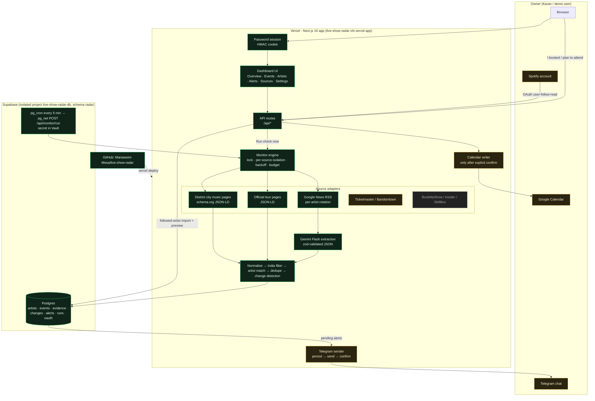

# Components Map

Status legend: ✅ working & verified live · 🟡 implemented, awaiting credentials/authorisation · ⛔ not available.

## Data flow (one monitoring run)

1. **Trigger**: Supabase `pg_cron` (every 5 min) or the dashboard's "Run check now" calls `POST /api/monitor/run` (Bearer `CRON_SECRET` or a dashboard session).
2. **Lock**: a partial unique index allows only one `running` row in `radar.monitor_runs`; stale locks (>10 min) are released.
3. **Source-aware scheduling**: each enabled source runs only if its own `poll_interval_minutes` elapsed and it isn't in backoff (District 30 min, Google News 60 min, official pages 6 h). The scheduler interval (5 min) ≠ source polling interval.
4. **Fetch**: timeouts (12 s), concurrency limits (2–3), conditional requests (ETag) for District, rotating artist batches for News.
5. **Extract**: JSON-LD parsed deterministically; news headlines go through Gemini with a strict response schema, validated with zod; unchanged feeds are skipped via `radar.source_documents` hashes.
6. **Normalise → India filter → match**: whole-word name/alias matching; short or generic names only match an explicit performer field.
7. **Dedupe**: `dedupe_key = artist | city | IST day` (unique). Evidence from each source is attached to the canonical event.
8. **Change detection**: date, venue, ticket status, price, booking link, early-bird; cancellations/postponements/sold-out are distinct kinds. News never overrides structured ticketing data.
9. **Alerts**: inserted with an idempotency key (`new:<event>` / `upd:<event>:<hash>`), then delivered; marked `delivered` only on Telegram `ok:true`; failures back off exponentially and can be retried manually.
10. **Calendar**: only `POST /api/events/:id/confirm` with `{confirmation, explicit:true}` writes to Google Calendar, using a deterministic `iCalUID` + stored event ID to prevent duplicates.

## Credential/config flows

| Integration | Where configured | Flow |
|---|---|---|
| Supabase | Vercel Marketplace integration (env auto-injected) | Server connects with `POSTGRES_URL`; schema `radar` not exposed via Data API; RLS on |
| Gemini | Vercel env `GEMINI_API_KEY`, `GEMINI_MODEL` | Server-side fetch only |
| Telegram | Vercel env `TELEGRAM_BOT_TOKEN`, `TELEGRAM_CHAT_ID` | Settings → find chat ID via `getUpdates` → send test |
| Spotify | Vercel env `SPOTIFY_CLIENT_ID/SECRET` + redirect URI | `/api/spotify/login` → callback (signed state) → tokens in `radar.oauth_connections` |
| Google | Vercel env `GOOGLE_CLIENT_ID/SECRET` + redirect URI | `/api/google/login` → callback → refresh token stored server-side |
| Scheduler | `scripts/setup-cron.mjs` | Secret + URL stored in Supabase Vault |
